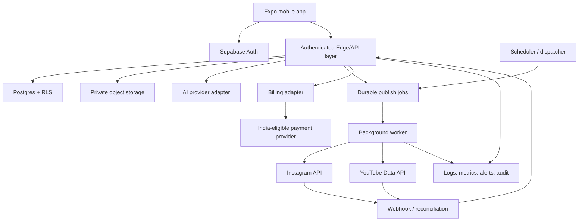

# AXIOM Social — Verified Production Readiness Audit

**Audit date:** 2026-10-12  
**Repository audited:** https://github.com/shivatmprakash9009-eng/axiom-social  
**Branch inspected:** `main`  
**Scope:** Read-only codebase and workflow audit; this document does not claim any provider integration is live.

## Executive decision

The repository is a polished React Native / Expo / TypeScript mobile prototype with a successful Android release-build pipeline. It is **not yet a production SaaS**: there is no backend implementation, Supabase project configuration, database migration, authentication flow, social OAuth connector, AI provider, persistent draft storage, durable scheduler, real inbox, analytics ingestion, team/workspace authorization, or billing integration in the audited tree.

The current UI deliberately labels sample data and disabled integrations. Preserve that honesty while implementing real services behind explicit capability flags. Do not replace sample UI with fabricated "connected" states.

## Verified repository facts

The recursive GitHub tree for `main` contains:
- Expo Router screens: Home, Planner, Assistant, Inbox, Insights, Compose, Settings.
- Shared UI components and theme tokens under `mobile/src`.
- `mobile/package.json` with Expo SDK 54, React Native 0.81.5, TypeScript, Expo Router, image picker, Reanimated and AsyncStorage.
- Documentation: `docs/architecture.md`, `docs/integration-capabilities.md`, `docs/acceptance-criteria.md`.
- Android APK and mobile-check GitHub Actions workflows.
- `mobile/.env.example` with only `EXPO_PUBLIC_API_BASE_URL`.

The following were **not present in the audited tree**: Supabase client/server code, `supabase/` migrations/functions, server package, API route handlers, queue/worker implementation, provider OAuth callbacks, webhook handlers, payment integration, test suite for business logic, or CI database/integration tests.

Screens inspected confirm the current limitations:
- Home displays sample planner counts and draft counts, and explicitly states OAuth is not configured.
- Settings Connect actions show a notice; they do not start OAuth. Automation switches are local UI state only.
- Composer media selection is local; its save action keeps state only for the current session, and publishing is disabled.
- Inbox contains example threads and reply drafts; it explicitly does not send replies.
- Insights uses illustrative chart data and labels it as sample-only.
- Assistant keeps messages in component state and does not call a model/backend.

### Build pipeline observation

The latest inspected Android workflow run completed successfully and uploaded a 34.3 MB compressed workflow artifact. The GitHub release currently has both the older `axiom-social-debug.apk` and newer `axiom-social.apk` assets; the newer release APK is approximately 83.9 MB. This verifies packaging and upload, **not** a full device acceptance test, successful social OAuth, or production readiness.

The current mobile-check workflow runs dependency compatibility and TypeScript checks, but there are no observed automated tests for authorization isolation, OAuth, publish idempotency, scheduler reliability, billing webhooks, or platform connectors.

## Gap analysis

| Area | Verified current state | Production gap | Priority |
|---|---|---|---|
| Mobile UX | Strong visual scaffold; sample states are labelled | Authenticated/unauthenticated navigation, API state handling, accessibility and device QA | P0 |
| Authentication | No real login/session flow in tree | Supabase Auth, session refresh, account recovery, Google OAuth configuration | P0 |
| Workspace tenancy | Audience includes creators and agencies; no backend membership model | Organizations/workspaces, membership roles, invitations, tenant isolation and RLS | P0 |
| Database | No migrations or schema found | Versioned Postgres schema, constraints, indexes, migration CI and backups | P0 |
| Social OAuth | Connect buttons are placeholders | Provider app setup, exact scopes, callback validation, token encryption/refresh/revocation, app review | P0 |
| AI | Assistant is local UI state | Provider adapter, structured outputs, usage budgets, timeout/fallback, prompt-injection controls | P0 |
| Draft/media | Media picker is local; draft is session-only | Durable drafts, storage policies, upload progress, platform-specific validation and deletion | P0 |
| Publishing/scheduling | Sample calendar; no durable jobs | Persistent queue, timezone-safe scheduling, retries, idempotency, reconciliation and per-target status | P0 |
| Inbox/comments | Example threads and unsent reply drafts | Supported provider reads/replies, permissions, webhooks/polling, rate limits, moderation and escalation | P1 |
| Analytics | Illustrative charts | API-backed metrics, attribution windows, sync status, data freshness and quota-aware ingestion | P1 |
| Media editor | Media selection and preview only | Scope the MVP editor; non-destructive edits, platform constraints, exports and device testing | P1 |
| Teams/approvals | UI switches only | Server-enforced RBAC, approval records, audit trail, separation of duties | P1 |
| Billing | No billing implementation | Plans, entitlements, payment provider, signed webhooks, cancellation/refund/grace-period handling | P1 |
| Operations | Build workflows only | Error tracking, structured logs, metrics, alerting, runbooks, backups and incident response | P1 |
| Quality | Typecheck/dependency check; no business test suite observed | Unit, RLS, API integration, provider contract, E2E, load and recovery tests | P0 |

P0 means required before a closed production pilot; P1 means required before broad paid rollout, except where an API permission or policy blocks the feature earlier.

## Recommended production architecture

### Default deployment recommendation

Start with a managed, low-operations stack:
- **Mobile:** existing Expo + React Native + TypeScript app; retain the visual identity but move toward monochrome dark/light themes, a single electric-blue/purple accent for AI actions, readable sans-serif typography, restrained motion, and accessible contrast.
- **Identity:** Supabase Auth (email/password plus Google OAuth initially). Add MFA for owners/admins and recovery flows before public launch.
- **Data:** Supabase PostgreSQL with migrations, tenant-aware Row Level Security, and private Supabase Storage buckets.
- **Request/control plane:** Supabase Edge Functions for authenticated API operations, OAuth callbacks, webhook validation, and short request/response tasks. Use a separate server/worker for long-running media processing or provider operations that exceed edge execution limits.
- **Scheduler/queue:** Postgres-backed durable job records and Supabase Cron for dispatch at low scale. Use a proper queue/worker consumer with leases, bounded retries, dead-letter state and idempotency. Supabase Queues/pgmq or a managed queue may be selected after throughput and operational constraints are measured; do not rely on the phone staying open.
- **Worker hosting:** begin with a small managed container worker (provider selected after workload/region/cost review) for media processing and long-running upload jobs. Keep it stateless and horizontally replaceable.
- **AI:** provider-neutral server-side adapter with per-provider implementations, structured request/response schema, timeout, retries, token/cost limits, moderation and telemetry. Start with one provider; allow switching through server configuration without shipping secrets to mobile.
- **Payments:** for an India-first launch, evaluate Razorpay Subscriptions (or another India-eligible provider) behind a billing adapter. Verify legal entity eligibility, recurring mandate flow, taxes/invoices, refunds and webhook behavior before committing. Do not assume Stripe Billing subscriptions are available for an India-based account; Stripe's current subscription availability documentation lists India among unsupported countries.
- **Web/admin:** defer a full web dashboard until the mobile workflows and tenant/role model are stable, but design backend contracts to support a future web client.

### Logical architecture

### Core data model (initial proposal)

- `profiles`: user profile, locale, timezone, preferences.
- `workspaces`: creator/agency workspace, plan, lifecycle state.
- `workspace_members`: user, workspace, role, invitation status.
- `social_accounts`: workspace, provider, external account/channel ID, encrypted token reference, scopes, expiry, status, last health check.
- `oauth_states`: short-lived, single-use state/PKCE records with expiry.
- `media_assets`: workspace, storage key, MIME, byte size, checksum, processing state, retention metadata.
- `drafts`: owner/workspace, title, content, media references, version, status.
- `post_targets`: draft/campaign, provider account, platform-specific metadata, scheduled time and timezone, independent target state.
- `publish_jobs`: target, idempotency key, lease, attempts, next run, provider request/result IDs, error category.
- `approvals`: target/version, requested by, approver, decision, timestamps and comment.
- `inbox_threads` / `inbox_messages`: provider IDs, sync cursor, privacy/retention metadata; only supported API fields.
- `analytics_snapshots`: account/content metric, period, source timestamp, fetched timestamp, freshness.
- `ai_runs`: model/provider, purpose, token/cost estimates, latency, safe metadata; avoid storing unnecessary raw private prompts.
- `subscriptions`, `billing_events`: provider IDs, current entitlement state and idempotently processed webhook IDs.
- `audit_events`: actor, workspace, action, target, outcome and safe metadata.

All workspace-owned rows must carry a workspace ID and be protected by RLS. Membership and role checks must be performed on the server for every privileged operation; hiding a button is not authorization.

## API feasibility matrix

Status meanings: **Feasible with conditions** means official API support exists for an eligible account and approved scopes; it is not implemented or approved in this repo. **Restricted/verify** means provider eligibility, app review, quota or policy must be tested before promising it. **Not established** means the audited repo has no implementation evidence.

| Capability | Instagram | YouTube | Product decision |
|---|---|---|---|
| OAuth/account connection | Feasible with conditions for eligible professional Business/Creator accounts and approved Instagram login permissions | Feasible with Google OAuth and authorized YouTube scopes | P0; create provider apps and test full callback/refresh/revoke flow |
| Publish content | Supported surfaces depend on account/API route, media type and permissions; consumer personal accounts are not covered by the professional-account API route described in Meta docs | Video upload and metadata supported; `status.publishAt` can schedule a never-published private video | P0; no general promise until app review and real test account pass |
| Scheduling | App-side scheduler can dispatch a publish job when due, subject to API publishing rules/limits | API supports `publishAt` under documented private/unpublished conditions; otherwise app scheduler can upload/set state | P0; store UTC instant + IANA timezone and show provider-specific behavior |
| Comments | Read/reply operations available with specific permissions and account eligibility | Comments endpoints support eligible channel/video comment operations and OAuth scopes | P1; implement comment inbox first, separately from DMs |
| Direct messages | Instagram messaging APIs exist with account/scope/entry-point restrictions and review; do not assume all conversations are available | YouTube does not provide a general creator DM inbox through YouTube Data API | P1; Instagram-only where approved; explicitly unavailable for YouTube |
| Analytics | Eligible professional account insights with metric/time/account constraints | Channel/video analytics require YouTube Analytics API and appropriate owner authorization | P1; expose only metrics returned by authorized APIs, with freshness timestamps |
| Media constraints/editor | Must validate publishing formats, aspect ratio, file size, duration and media container state for each surface | Validate upload formats, metadata and current Shorts/video rules separately | P1; preflight validation and clear per-platform errors |
| Team approvals | Internal product feature, independent of provider | Internal product feature, independent of provider | Feasible; enforce server-side roles and immutable approval history |
| Billing | Independent of social APIs | Independent of social APIs | Feasible; India-first provider due diligence required |
| Multi-platform publish | Each platform target is a separate operation and may partially fail | Each platform target is a separate operation and may partially fail | Required: per-target status, no false overall success, idempotent reconciliation |

### Important API constraints to plan for

1. Meta's official Instagram API materials distinguish professional accounts and permission sets. Instagram Login has its own scope names such as `instagram_business_basic`, `instagram_business_content_publish`, `instagram_business_manage_comments`, and `instagram_business_manage_messages`; permission names and review requirements must be verified against the chosen login path when implementing.
2. YouTube Data API uploads require OAuth. Unverified API projects can have uploads restricted to private visibility until the project passes the required audit. YouTube API quota allocation and cost rules can change; the currently surfaced docs describe separate upload quota and other method limits, so quotas must be monitored rather than hard-coded as a permanent assumption.
3. The app must let users choose target platforms and set YouTube title, description and privacy settings before upload, as required by YouTube's minimum-functionality guidance.
4. No API capability in this matrix is considered live until real authorized-account tests and review requirements pass.

## Security plan

### Identity and tenant isolation
- Supabase Auth sessions; server validates JWT on every authenticated request.
- RLS enabled for every user/workspace table; default deny. Automated cross-tenant tests must prove user A cannot read or mutate workspace B.
- Roles initially: owner, admin, editor, approver, analyst, viewer. Least privilege and server-side checks for every action.
- Invite tokens are random, expiring, single-use and bound to a workspace/email.

### OAuth and secrets
- Validate OAuth state, use PKCE where supported, enforce exact redirect URIs and one-time state.
- Exchange authorization codes server-side. Never put provider client secrets, access tokens, refresh tokens, Supabase service-role keys, AI keys or payment secrets in mobile code, `EXPO_PUBLIC_*`, Git, crash logs or analytics.
- Encrypt provider tokens at rest using a managed secret/encryption facility; restrict decrypt operations to connector workers. Record scopes, expiry and revocation state.
- Support disconnect/revoke, token refresh races, rotation, and deletion/retention policy.

### Publishing and job safety
- Validate workspace membership, account ownership, scope, platform metadata, media and approval policy before enqueue.
- Use idempotency keys, unique constraints and durable state transitions. Do not blindly retry after timeout if the provider may have accepted a publish; reconcile by provider ID/status first.
- Worker leases/heartbeats, bounded exponential backoff with jitter, retry classification and dead-letter/manual recovery.
- Keep an append-only audit trail for draft edits, approval decisions, publish requests and billing entitlement changes.
- Human approval is a backend policy, not a UI toggle. Default to approval required for first launch.

### AI safety and cost
- Model calls happen only server-side through a provider adapter.
- Treat captions, imported comments, media OCR/transcripts and user-provided links as untrusted data; prevent instructions in content from invoking privileged tools.
- AI can draft and recommend. It cannot bypass roles, approval policy, API capabilities or payment entitlements.
- Enforce per-workspace quotas, rate limits, token budgets, timeouts and cost telemetry. Avoid sending private messages or account data to a model unless necessary and disclosed.
- Require explicit user confirmation before publishing or sending any reply during initial rollout.

### Storage, privacy and operations
- Private buckets; short-lived signed URLs; MIME/size validation and content checks; no public storage of private uploads by default.
- Verify payment webhooks with signatures, deduplicate event IDs and update entitlements transactionally.
- Redact tokens, authorization headers, raw payment details and sensitive content from logs.
- Set data retention/deletion controls, user disconnect/delete flows, backups, recovery objectives, incident contact and access review.
- Rate limit auth, AI, upload initiation, publish and webhook endpoints. Add dependency scanning, secret scanning, pinned/controlled CI permissions, and staging/prod separation.

## Milestones and exit gates

### M0 — Product and provider readiness
- Confirm Meta/Google developer app ownership, legal entity/account eligibility, required scopes, test accounts, review/audit requirements and budget.
- Write provider capability and data-retention decisions.
- **Exit:** documented scopes and an integration test plan; no provider feature advertised as live.

### M1 — Secure foundation
- Supabase project environments, schema migrations, Auth, workspace membership/RBAC, RLS, Storage, typed API client, error reporting and secrets.
- **Exit:** cross-tenant tests pass; auth/recovery works; no service-role secret in client bundle.

### M2 — Drafts, media and AI
- Persistent draft CRUD, private upload, media validation, provider-independent AI adapter, usage controls, versioned content and per-platform previews.
- **Exit:** restart/relogin retains authorized drafts; AI errors/timeouts are handled; no secrets shipped to app.

### M3 — Social connections
- Instagram and YouTube OAuth, token refresh/revocation, account health and scoped capability display.
- **Exit:** each connector passes an authorized test account from connect through disconnect; permission denial and token expiry tests pass.

### M4 — Publishing and scheduling
- Durable scheduler/worker, per-target state, approvals, idempotency, reconciliation, retries and notifications.
- **Exit:** app can be closed and scheduled work still executes; ambiguous outcomes do not create duplicates; partial success is represented accurately.

### M5 — Inbox and analytics
- Start with supported comments and metrics, then add Instagram messaging only after permission/eligibility validation.
- **Exit:** data freshness, pagination, quota handling, unsupported surfaces and permission errors are surfaced.

### M6 — Teams and billing
- Invitations, role management, approval policy, subscription checkout, verified webhook processing and entitlements.
- **Exit:** role escalation tests fail safely; duplicate/out-of-order billing webhooks do not corrupt entitlement state; cancellation and payment failure flows are tested.

### M7 — Production release
- Load, device, accessibility, security, backup/restore, monitoring, runbook, release signing and store policy checks.
- **Exit:** critical/high security findings closed, release rollback tested, crash/error monitoring live, and support/incident ownership defined.

## Acceptance criteria (release blockers)

- [ ] No fake account connections, metrics, inbox data or publish success presented as real.
- [ ] Login, logout, recovery and session expiry work on device.
- [ ] RLS and automated tests prevent cross-workspace access for every protected entity.
- [ ] Draft/media state persists across app restart and authorized devices.
- [ ] OAuth state validation, scope handling, refresh, revoke and disconnect work end-to-end.
- [ ] Publish flow validates content and account eligibility; requires approval according to server policy.
- [ ] Scheduled jobs run without the mobile app open and have inspectable job IDs/status/history.
- [ ] Provider timeouts are reconciled before retry; no duplicate publish caused by blind retry.
- [ ] Each platform target has independent state and honest partial-success reporting.
- [ ] Inbox only exposes supported, authorized operations; reply send is explicitly confirmed.
- [ ] Analytics includes source, period and last-updated timestamp; unavailable metrics are omitted, not fabricated.
- [ ] Billing webhooks are signature-verified, deduplicated and idempotent; entitlements are server-derived.
- [ ] Secrets are absent from the client bundle, Git, logs and artifacts.
- [ ] Automated tests cover authorization, RLS, validation, queue transitions, retries, webhook dedupe and provider adapters.
- [ ] Android and iOS smoke tests, accessibility review, crash monitoring, backup/restore and rollback are documented.
- [ ] API usage, costs, queue depth, failed jobs and provider errors have alerts/runbooks.

## Essential unresolved decisions before production implementation

The brief resolves platforms, audience, priorities, AI portability, Supabase/Postgres, and visual direction. Only these decisions block implementation:
1. **Provider access:** who controls the Meta developer app and Google Cloud project, and are they already created/verified? Do not send credentials in chat.
2. **Launch platform:** Android-only closed pilot first, or Android + iOS from the first production beta? (The app is cross-platform, but release and device QA differ.)
3. **Billing launch:** should paid subscriptions be part of the first closed pilot, or can we launch with plans/entitlements disabled until provider onboarding and tax/invoice requirements are confirmed?

Default recommendation if undecided: Android-first closed pilot, Supabase Auth + Google/email, Supabase-managed Postgres/Storage/Edge Functions, one stateless worker for long-running jobs, and billing behind an adapter but disabled until verified. Keep the architecture portable and cost-controlled.
